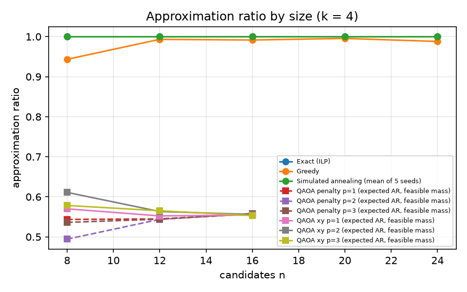
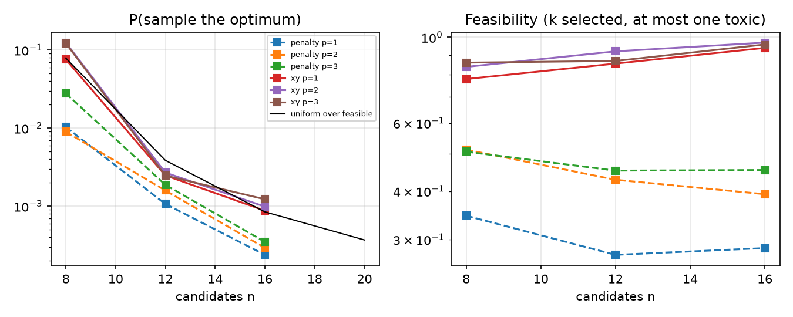
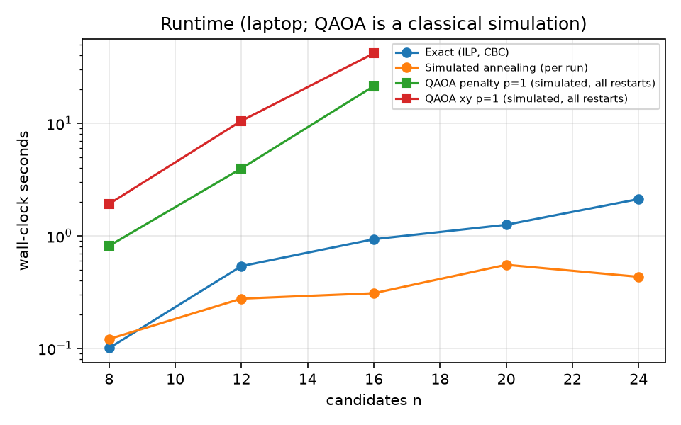
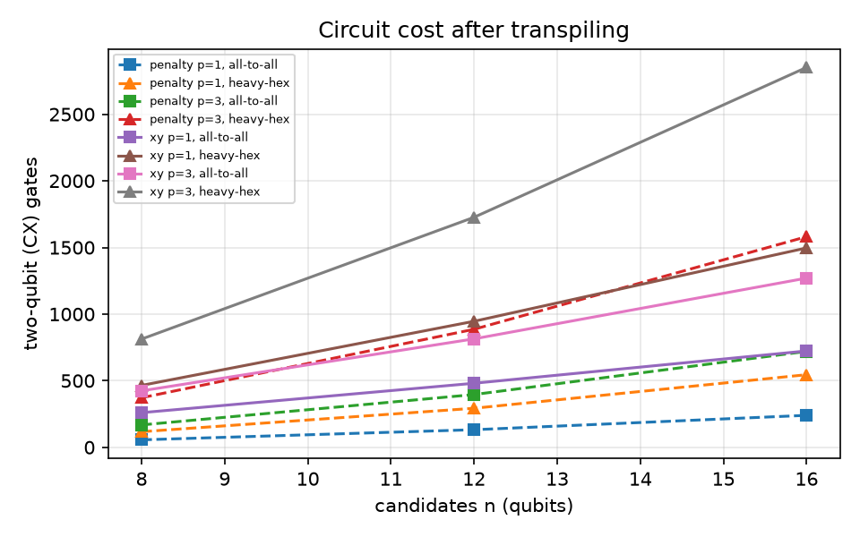
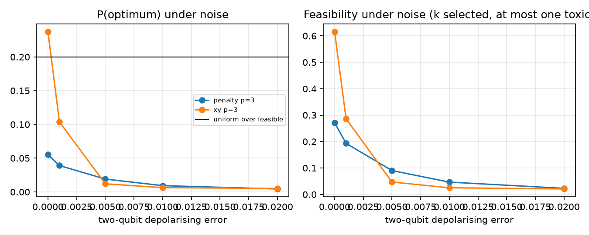

# Phase 8 results: choosing a re-test panel (generated)

Generated by `python -m lip m8 bench` and `pipeline/lip/m8/export.py` from `data/interim/m8/benchmark.json` and `data/interim/m8/panel.json`. Do not edit by hand. The formulation is in [QUBO.md](QUBO.md).

The panel optimises **model predictions**. Each entry is a hypothesis worth re-testing, never a claim that a preparation works or is safe.

## The recommended panel (exact solver, full pool, k = 8, toxic rule `exclude`)

Pool: 24 candidates (see `data/interim/m8/pool.json`). Weights: alpha = 1.0, beta_class = 0.2, beta_indication = 0.2, beta_prep = 0.2, gamma = 0.5.

| # | Species | Historical preparation | Modern comparator | Indication | Robust gap (5th / 50th / 95th) | Compounds likely to differ | Toxicity |
|---|---|---|---|---|---|---|---|
| 1 | *Ajuga chamaepitys* | decoction in water | modern methanol extract (default) | Jaundice | 0.234 / 0.376 / 0.545 | 33 | no_toxicity_reported |
| 2 | *Ajuga chamaepitys* | decoction in wine | modern methanol extract (default) | Gout | 0.222 / 0.375 / 0.542 | 31 | no_toxicity_reported |
| 3 | *Betonica officinalis* | decoction in wine | modern methanol extract (default) | Colic | 0.161 / 0.245 / 0.382 | 14 | unknown |
| 4 | *Galium aparine* | fresh juice | modern methanol extract (default) | Wounds and Injuries | 0.092 / 0.194 / 0.315 | 17 | no_toxicity_reported |
| 5 | *Raphanus sativus* | fresh juice | modern methanol extract | Ear Diseases | 0.090 / 0.156 / 0.247 | 133 | concern_reported |
| 6 | *Betonica officinalis* | powder taken whole | modern methanol extract (default) | Dyspepsia | 0.058 / 0.099 / 0.160 | 11 | unknown |
| 7 | *Galium aparine* | powder taken whole | modern methanol extract (default) | Skin Ulcer | 0.018 / 0.049 / 0.095 | 5 | no_toxicity_reported |
| 8 | *Raphanus sativus* | decoction in wine | decoction in water | Hernia | 0.003 / 0.013 / 0.044 | 0 | concern_reported |

**Selected on coverage, not value:** *Raphanus sativus* decoction in wine vs decoction in water (robust gap 0.003, no compound likely to differ). The coverage terms count attributes without a cap, so a candidate with several attested indications or a new preparation type can enter with a small gap (QUBO.md §2). The weights were fixed before the comparison and are not changed here.

Every panel entry carries its caveats and evidence trail in `site-data/lab_panel.json`.

### Other panel sizes and the toxic rule

| Toxic rule | k | Pool | Objective | Coverage (classes / indications / preparations) | Panel |
|---|---|---|---|---|---|
| exclude | 4 | 16 | 1.4822 | 5 / 15 / 3 | decoction in water|modern methanol extract (Ajuga chamaepitys); decoction in wine|modern methanol extract (Ajuga chamaepitys); decoction in wine|modern methanol extract (Betonica officinalis); fresh juice|modern methanol extract (Raphanus sativus) |
| exclude | 6 | 16 | 1.0923 | 5 / 18 / 4 | decoction in water|modern methanol extract (Ajuga chamaepitys); decoction in wine|modern methanol extract (Ajuga chamaepitys); decoction in wine|modern methanol extract (Betonica officinalis); fresh juice|modern methanol extract (Raphanus sativus); powder taken whole|modern methanol extract (Betonica officinalis); decoction in wine|decoction in water (Raphanus sativus) |
| at_most_one | 4 | 24 | 1.5709 | 5 / 16 / 3 | decoction in water|modern methanol extract (Ajuga chamaepitys); decoction in wine|modern methanol extract (Ajuga chamaepitys); decoction in wine|modern methanol extract (Betonica officinalis); fresh juice|modern methanol extract (Chelidonium majus) |
| at_most_one | 6 | 24 | 1.1513 | 5 / 19 / 4 | decoction in water|modern methanol extract (Ajuga chamaepitys); decoction in wine|modern methanol extract (Ajuga chamaepitys); decoction in wine|modern methanol extract (Betonica officinalis); fresh juice|modern methanol extract (Chelidonium majus); powder taken whole|modern methanol extract (Betonica officinalis); decoction in wine|decoction in water (Raphanus sativus) |
| at_most_one | 8 | 24 | 0.8366 | 5 / 19 / 5 | decoction in water|modern methanol extract (Ajuga chamaepitys); decoction in wine|modern methanol extract (Ajuga chamaepitys); decoction in wine|modern methanol extract (Betonica officinalis); fresh juice|modern methanol extract (Galium aparine); powder taken whole|modern methanol extract (Betonica officinalis); powder taken whole|modern methanol extract (Galium aparine); steeped in vinegar|decoction in water (Allium cepa); decoction in wine|decoction in water (Raphanus sativus) |

### Weight sensitivity (each weight ×0.5 and ×2, others fixed)

| Weight | Factor | Jaccard with the default panel | Added | Removed |
|---|---|---|---|---|
| alpha | 0.5 | 1.00 | — | — |
| alpha | 2.0 | 0.78 | wfo-0000134589|hot water infusion (tea)|modern methanol extract | wfo-0000402430|fresh juice|modern methanol extract |
| beta_class | 0.5 | 0.78 | wfo-0000134589|hot water infusion (tea)|modern methanol extract | wfo-0000968296|powder taken whole|modern methanol extract |
| beta_class | 2.0 | 1.00 | — | — |
| beta_indication | 0.5 | 0.78 | wfo-0000134589|hot water infusion (tea)|modern methanol extract | wfo-0000402430|fresh juice|modern methanol extract |
| beta_indication | 2.0 | 1.00 | — | — |
| beta_prep | 0.5 | 1.00 | — | — |
| beta_prep | 2.0 | 0.78 | wfo-0000134589|hot water infusion (tea)|modern methanol extract | wfo-0000402430|fresh juice|modern methanol extract |
| gamma | 0.5 | 1.00 | — | — |
| gamma | 2.0 | 1.00 | — | — |

## Benchmark

Instances: sizes [8, 12, 16, 20, 24] (3 sampled per size, seed 20261107 + 1000·n + i), plus the full pool. Benchmark instances use the `at_most_one` toxic rule, so that term is exercised. Annealing seeds [1, 2, 3, 4, 5]. QAOA: n ∈ [8, 12, 16], k = 4, p ∈ [1, 2, 3], COBYLA (maxiter 300) from 8 random restarts, seed 20261107, 4096 shots. Versions: python 3.11.14, qiskit 2.6.2, qiskit-aer 0.18.2, pulp 3.3.2, numpy 2.4.6, scipy 1.17.1.

Skipped as infeasible: n8-0 k = 6 (only 3 non-toxic candidates: no 6-panel has at most one toxic).

### Approximation ratio, success and runtime (k = 4)

| n | Solver | Depth | Instances | Mean AR | P(optimum) | Feasibility | Mean seconds | CX all-to-all | CX heavy-hex | Depth (all-to-all) |
|---|---|---|---|---|---|---|---|---|---|---|
| 8 | exact | — | 3 | 1.000 | — | — | 0.101 | — | — | — |
| 8 | greedy | — | 3 | 0.943 | 0.667 | — | 9.96e-05 | — | — | — |
| 8 | anneal | — | 3 | 1.000 | 1.000 | — | 0.121 | — | — | — |
| 8 | random | — | 3 | 0.521 | 0.079 | — | — | — | — | — |
| 8 | qaoa-penalty | 1 | 3 | 0.544 | 0.010 | 0.346 | 0.815 | 56 | 117 | 48 |
| 8 | qaoa-penalty | 2 | 3 | 0.494 | 0.009 | 0.512 | 8.33 | 112 | 232 | 78 |
| 8 | qaoa-penalty | 3 | 3 | 0.536 | 0.028 | 0.506 | 9.21 | 168 | 372 | 108 |
| 8 | qaoa-xy | 1 | 3 | 0.570 | 0.076 | 0.780 | 1.92 | 260 | 465 | 508 |
| 8 | qaoa-xy | 2 | 3 | 0.611 | 0.124 | 0.838 | 14 | 342 | 648 | 567 |
| 8 | qaoa-xy | 3 | 3 | 0.578 | 0.122 | 0.860 | 24.4 | 424 | 812 | 626 |
| 12 | exact | — | 3 | 1.000 | — | — | 0.538 | — | — | — |
| 12 | greedy | — | 3 | 0.993 | 0.667 | — | 0.000168 | — | — | — |
| 12 | anneal | — | 3 | 1.000 | 1.000 | — | 0.277 | — | — | — |
| 12 | random | — | 3 | 0.543 | 0.004 | — | — | — | — | — |
| 12 | qaoa-penalty | 1 | 3 | 0.545 | 0.001 | 0.274 | 3.98 | 132 | 293 | 72 |
| 12 | qaoa-penalty | 2 | 3 | 0.544 | 0.002 | 0.428 | 13.1 | 264 | 580 | 114 |
| 12 | qaoa-penalty | 3 | 3 | 0.544 | 0.002 | 0.452 | 24.9 | 396 | 886 | 156 |
| 12 | qaoa-xy | 1 | 3 | 0.552 | 0.002 | 0.855 | 10.5 | 481 | 946 | 862 |
| 12 | qaoa-xy | 2 | 3 | 0.563 | 0.003 | 0.919 | 35.9 | 647 | 1328 | 947 |
| 12 | qaoa-xy | 3 | 3 | 0.565 | 0.002 | 0.868 | 48.3 | 814 | 1727 | 1032 |
| 16 | exact | — | 3 | 1.000 | — | — | 0.934 | — | — | — |
| 16 | greedy | — | 3 | 0.992 | 0.667 | — | 0.000264 | — | — | — |
| 16 | anneal | — | 3 | 1.000 | 1.000 | — | 0.309 | — | — | — |
| 16 | random | — | 3 | 0.556 | 0.001 | — | — | — | — | — |
| 16 | qaoa-penalty | 1 | 3 | 0.557 | 0.000 | 0.285 | 21.4 | 240 | 545 | 96 |
| 16 | qaoa-penalty | 2 | 3 | 0.558 | 0.000 | 0.393 | 88.4 | 480 | 1026 | 150 |
| 16 | qaoa-penalty | 3 | 3 | 0.558 | 0.000 | 0.454 | 164 | 720 | 1581 | 204 |
| 16 | qaoa-xy | 1 | 3 | 0.555 | 0.001 | 0.938 | 41.8 | 723 | 1497 | 1214 |
| 16 | qaoa-xy | 2 | 3 | 0.556 | 0.001 | 0.968 | 189 | 997 | 2240 | 1323 |
| 16 | qaoa-xy | 3 | 3 | 0.553 | 0.001 | 0.958 | 235 | 1270 | 2852 | 1432 |
| 20 | exact | — | 3 | 1.000 | — | — | 1.25 | — | — | — |
| 20 | greedy | — | 3 | 0.996 | 0.667 | — | 0.000359 | — | — | — |
| 20 | anneal | — | 3 | 1.000 | 1.000 | — | 0.553 | — | — | — |
| 20 | random | — | 3 | 0.537 | 0.000 | — | — | — | — | — |
| 24 | exact | — | 1 | 1.000 | — | — | 2.12 | — | — | — |
| 24 | greedy | — | 1 | 0.988 | 0.000 | — | 0.000445 | — | — | — |
| 24 | anneal | — | 1 | 1.000 | 1.000 | — | 0.433 | — | — | — |
| 24 | random | — | 1 | 0.540 | — | — | — | — | — | — |

For greedy and annealing, P(optimum) is the share of instances (greedy) or of runs (annealing) that returned an optimal panel. For QAOA it is the exact statevector probability of sampling one, and for random it is the uniform probability over feasible panels.
Feasibility counts both constraints: exactly k selected and at most one toxic. The XY ansatz keeps exactly k selected with probability 1 (Dicke start and Hamming-weight-preserving mixer, both tested), so its shortfall below 1 is panels with two or more toxic candidates, which only the cost penalises. The penalty ansatz misses both constraints.

### Classical results at k = 6 and 8

| n | k | Greedy mean AR | Annealing mean AR | Annealing success | Exact mean seconds |
|---|---|---|---|---|---|
| 8 | 6 | 1.000 | 1.000 | 1.000 | 0.0957 |
| 12 | 6 | 0.996 | 1.000 | 1.000 | 0.985 |
| 12 | 8 | 0.826 | 1.000 | 1.000 | 0.0522 |
| 16 | 6 | 0.997 | 1.000 | 1.000 | 2.5 |
| 16 | 8 | 0.967 | 1.000 | 1.000 | 0.645 |
| 20 | 6 | 0.972 | 1.000 | 1.000 | 2.18 |
| 20 | 8 | 0.970 | 1.000 | 1.000 | 1.07 |
| 24 | 6 | 0.993 | 1.000 | 1.000 | 2.56 |
| 24 | 8 | 0.982 | 1.000 | 1.000 | 3.71 |

### Which method wins at each size (k = 4)

- n = 8: exact ILP (0.101 s mean) is the fastest to return the optimum on every instance; also optimal every time: simulated annealing; only the ILP proves optimality. QAOA (simulated): best mean P(optimum) 0.124 (xy mixer, p = 2) vs 0.079 for a uniform random feasible panel, i.e. 1.58× uniform
- n = 12: simulated annealing (0.277 s mean) is the fastest to return the optimum on every instance; also optimal every time: exact ILP; only the ILP proves optimality. QAOA (simulated): best mean P(optimum) 0.003 (xy mixer, p = 2) vs 0.004 for a uniform random feasible panel, i.e. 0.70× uniform
- n = 16: simulated annealing (0.309 s mean) is the fastest to return the optimum on every instance; also optimal every time: exact ILP; only the ILP proves optimality. QAOA (simulated): best mean P(optimum) 0.001 (xy mixer, p = 3) vs 0.001 for a uniform random feasible panel, i.e. 1.45× uniform
- n = 20: simulated annealing (0.553 s mean) is the fastest to return the optimum on every instance; also optimal every time: exact ILP; only the ILP proves optimality
- n = 24: simulated annealing (0.433 s mean) is the fastest to return the optimum on every instance; also optimal every time: exact ILP; only the ILP proves optimality

## Noise (parametric depolarising noise (Qiskit Aer) on a heavy-hex coupling map; not a device calibration)

Instance n8-0 (k = 4). Each variant runs at the depth with its best noise-free P(optimum), with its noise-free optimal parameters (not re-optimised under noise). Uniform P(optimum) over feasible panels: 0.200; random feasible AR 0.633.

| Variant | p | 2-qubit error | 1-qubit error | Readout | P(optimum) | Feasibility | Mean AR (feasible) |
|---|---|---|---|---|---|---|---|
| penalty | 3 | 0.0 | 0.0000 | 0.0 | 0.055 | 0.271 | 0.640 |
| penalty | 3 | 0.001 | 0.0001 | 0.02 | 0.039 | 0.193 | 0.633 |
| penalty | 3 | 0.005 | 0.0005 | 0.02 | 0.019 | 0.090 | 0.628 |
| penalty | 3 | 0.01 | 0.0010 | 0.02 | 0.009 | 0.047 | 0.647 |
| penalty | 3 | 0.02 | 0.0020 | 0.02 | 0.004 | 0.023 | 0.645 |
| xy | 3 | 0.0 | 0.0000 | 0.0 | 0.238 | 0.616 | 0.609 |
| xy | 3 | 0.001 | 0.0001 | 0.02 | 0.104 | 0.286 | 0.587 |
| xy | 3 | 0.005 | 0.0005 | 0.02 | 0.012 | 0.047 | 0.599 |
| xy | 3 | 0.01 | 0.0010 | 0.02 | 0.006 | 0.025 | 0.631 |
| xy | 3 | 0.02 | 0.0020 | 0.02 | 0.005 | 0.021 | 0.629 |

## Hardware

- **ibmQuantum:** not used: no IBM Quantum account or token on this machine, and none was created
- **ionqQollab:** not used: needs the project lead's own account
- **substitute:** parametric noise-model simulation (Qiskit Aer)

## Figures

