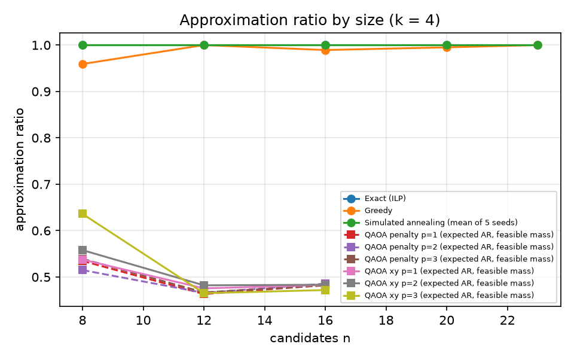
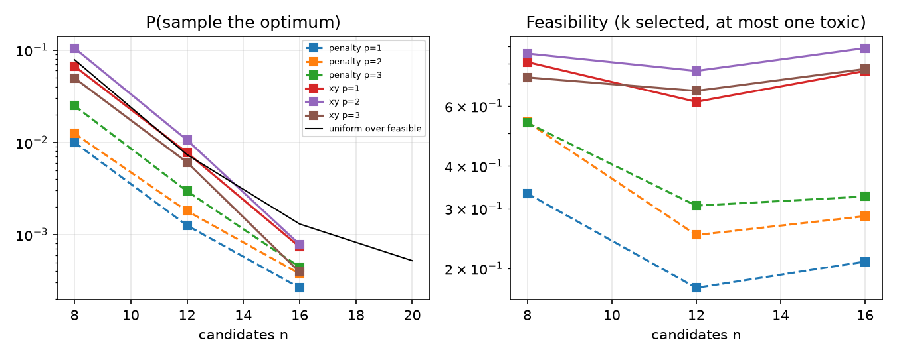
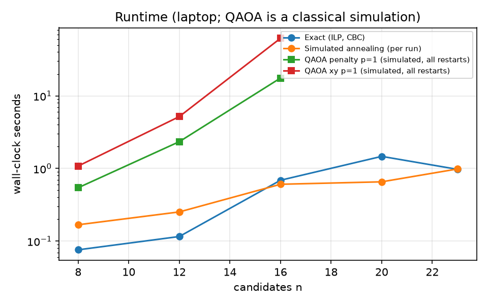
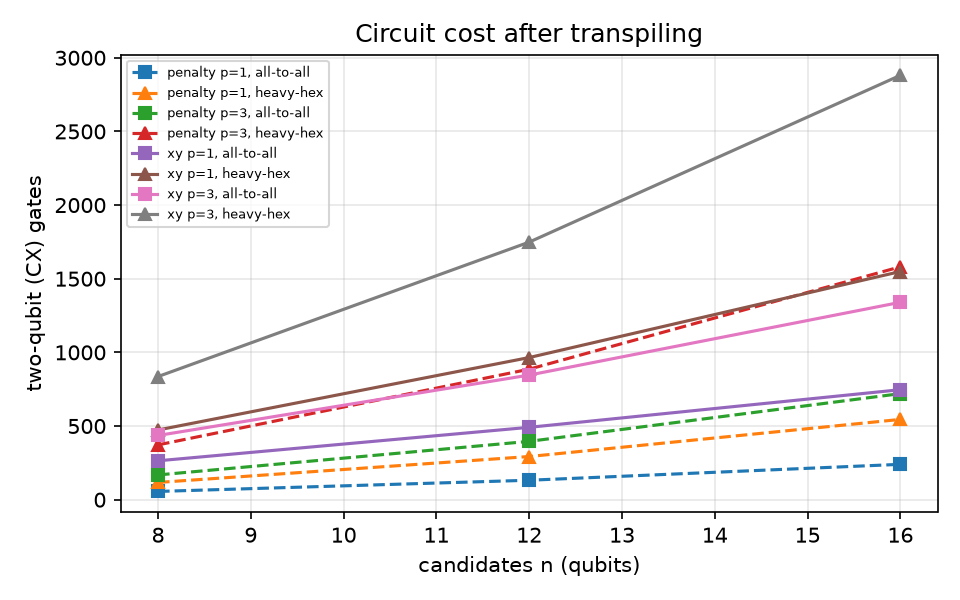
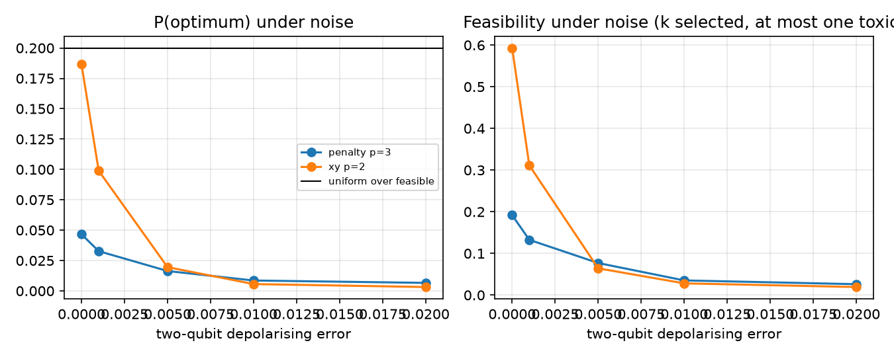

# Phase 8 results: choosing a re-test panel (generated)

Generated by `python -m lip m8 bench` and `pipeline/lip/m8/export.py` from `data/interim/m8/` (benchmark_v2, panel_v2, and the v1 files). Do not edit by hand. The formulation is in [QUBO.md](QUBO.md); the v2 rule, pre-registered before any v2 run, is in [QUBO_v2_RULE.md](QUBO_v2_RULE.md).

The panel optimises **model predictions**. Each entry is a hypothesis worth re-testing, never a claim that a preparation works or is safe.

## The displayed panel: v2 (exact solver, k = 8, toxic-reported species excluded, at most 1 per species)

Eligible pool after the v2 rule: 15 candidates. Weights unchanged from v1: alpha = 1.0, beta_class = 0.2, beta_indication = 0.2, beta_prep = 0.2, gamma = 0.5.

| # | Species | Historical preparation | Modern comparator | Indication | Robust gap (5th / 50th / 95th) | Compounds likely to differ | Toxicity |
|---|---|---|---|---|---|---|---|
| 1 | *Ajuga chamaepitys* | decoction in water | modern methanol extract (default) | Jaundice | 0.234 / 0.376 / 0.545 | 33 | no_toxicity_reported |
| 2 | *Artemisia absinthium* | hot water infusion (tea) | modern methanol extract (default) | Flatulence | 0.210 / 0.323 / 0.475 | 110 | concern_reported |
| 3 | *Betonica officinalis* | decoction in wine | modern methanol extract (default) | Colic | 0.161 / 0.245 / 0.382 | 14 | unknown |
| 4 | *Raphanus sativus* | cold water infusion | modern methanol extract | Poisoning | 0.136 / 0.219 / 0.338 | 94 | concern_reported |
| 5 | *Agrimonia eupatoria* | fresh juice | modern methanol extract (default) | Ear Diseases | 0.060 / 0.105 / 0.173 | 7 | no_toxicity_reported |
| 6 | *Filipendula ulmaria* | decoction in wine | modern methanol extract (default) | Diarrhea | 0.047 / 0.101 / 0.178 | 8 | concern_reported |
| 7 | *Humulus lupulus* | powder taken whole | modern methanol extract (default) | Diuresis | 0.020 / 0.032 / 0.050 | 118 | no_toxicity_reported |
| 8 | *Galium aparine* | powder taken whole | modern methanol extract (default) | Skin Ulcer | 0.018 / 0.049 / 0.095 | 5 | no_toxicity_reported |

**Not eligible under v2:** *Raphanus sativus* decoction in wine vs decoction in water (0 compounds likely to differ (needs at least 1)).

**Excluded because toxicity is reported (8):** *Allium cepa* fresh juice vs modern methanol extract; *Allium cepa* steeped in vinegar vs decoction in water; *Chelidonium majus* fresh juice vs modern methanol extract; *Chelidonium majus* infused oil vs modern methanol extract; *Chelidonium majus* powder taken whole vs modern methanol extract; *Glycyrrhiza glabra* decoction in water vs modern methanol extract; *Glycyrrhiza glabra* powder taken whole vs modern methanol extract; *Hyoscyamus niger* decoction in wine vs modern methanol extract.

## v1 and v2 side by side (k = 8)

| Slot | v1 (original result) | v2 (displayed) |
|---|---|---|
| 1 | *Ajuga chamaepitys* decoction in water (gap 0.234) | *Ajuga chamaepitys* decoction in water (gap 0.234) |
| 2 | *Ajuga chamaepitys* decoction in wine (gap 0.222) | *Artemisia absinthium* hot water infusion (tea) (gap 0.210) |
| 3 | *Betonica officinalis* decoction in wine (gap 0.161) | *Betonica officinalis* decoction in wine (gap 0.161) |
| 4 | *Galium aparine* fresh juice (gap 0.092) | *Raphanus sativus* cold water infusion (gap 0.136) |
| 5 | *Raphanus sativus* fresh juice (gap 0.090) | *Agrimonia eupatoria* fresh juice (gap 0.060) |
| 6 | *Betonica officinalis* powder taken whole (gap 0.058) | *Filipendula ulmaria* decoction in wine (gap 0.047) |
| 7 | *Galium aparine* powder taken whole (gap 0.018) | *Humulus lupulus* powder taken whole (gap 0.020) |
| 8 | *Raphanus sativus* decoction in wine (gap 0.003) | *Galium aparine* powder taken whole (gap 0.018) |

Objective: v1 0.7448, v2 0.1433. They are not directly comparable: v2 optimises over a smaller set under stricter constraints, so its optimum can only be lower or equal.

- **v1 note:** Slot 8 (Raphanus sativus, decoction in wine vs decoction in water) was selected on coverage, not value: robust gap 0.003 and no compound likely to differ.
- **v1 note:** Several entries share a species: Ajuga chamaepitys, Betonica officinalis, Galium aparine, Raphanus sativus.

### Other panel sizes, and at most two per species (sensitivity)

| Rule | k | Pool | Objective | Coverage (classes / indications / preparations) | Panel |
|---|---|---|---|---|---|
| v2, ≤1/species | 4 | 15 | 1.4273 | 5 / 13 / 4 | *Ajuga chamaepitys* decoction in water; *Betonica officinalis* decoction in wine; *Raphanus sativus* fresh juice; *Galium aparine* powder taken whole |
| v2, ≤1/species | 6 | 15 | 0.8587 | 5 / 14 / 6 | *Ajuga chamaepitys* decoction in water; *Artemisia absinthium* hot water infusion (tea); *Betonica officinalis* decoction in wine; *Raphanus sativus* cold water infusion; *Agrimonia eupatoria* fresh juice; *Galium aparine* powder taken whole |
| v2, ≤2/species | 4 | 15 | 1.4822 | 5 / 15 / 3 | *Ajuga chamaepitys* decoction in water; *Ajuga chamaepitys* decoction in wine; *Betonica officinalis* decoction in wine; *Raphanus sativus* fresh juice |
| v2, ≤2/species | 6 | 15 | 1.0341 | 5 / 17 / 4 | *Ajuga chamaepitys* decoction in water; *Ajuga chamaepitys* decoction in wine; *Betonica officinalis* decoction in wine; *Raphanus sativus* fresh juice; *Betonica officinalis* powder taken whole; *Galium aparine* powder taken whole |
| v2, ≤2/species | 8 | 15 | 0.5909 | 5 / 18 / 5 | *Ajuga chamaepitys* decoction in water; *Ajuga chamaepitys* decoction in wine; *Artemisia absinthium* hot water infusion (tea); *Betonica officinalis* decoction in wine; *Galium aparine* fresh juice; *Agrimonia eupatoria* fresh juice; *Betonica officinalis* powder taken whole; *Galium aparine* powder taken whole |

### Weight sensitivity of the v2 panel (each weight ×0.5 and ×2, others fixed)

| Weight | Factor | Jaccard with the default panel | Added | Removed |
|---|---|---|---|---|
| alpha | 0.5 | 0.78 | *Betonica officinalis* powder taken whole | *Betonica officinalis* decoction in wine |
| alpha | 2.0 | 1.00 | — | — |
| beta_class | 0.5 | 1.00 | — | — |
| beta_class | 2.0 | 0.78 | *Betonica officinalis* powder taken whole | *Betonica officinalis* decoction in wine |
| beta_indication | 0.5 | 0.78 | *Betonica officinalis* powder taken whole | *Betonica officinalis* decoction in wine |
| beta_indication | 2.0 | 0.78 | *Raphanus sativus* fresh juice | *Raphanus sativus* cold water infusion |
| beta_prep | 0.5 | 1.00 | — | — |
| beta_prep | 2.0 | 1.00 | — | — |
| gamma | 0.5 | 1.00 | — | — |
| gamma | 2.0 | 1.00 | — | — |

## Benchmark (v2 instances)

Instances: sizes [8, 12, 16, 20, 24] (3 sampled per size, seed 20261107 + 1000·n + i), plus the full v2 pool (23 candidates). Constraints: at most one toxic, at most 1 per species. Annealing seeds [1, 2, 3, 4, 5]. QAOA: n ∈ [8, 12, 16], k = 4, p ∈ [1, 2, 3], COBYLA (maxiter 300) from 8 random restarts, seed 20261107, 4096 shots. Versions: python 3.11.14, qiskit 2.6.2, qiskit-aer 0.18.2, pulp 3.3.2, numpy 2.4.6, scipy 1.17.1.

Skipped as infeasible: n8-0 k = 6 (the largest panel the limits allow has 4 entries: no 6-panel is feasible); n12-0 k = 8 (the largest panel the limits allow has 7 entries: no 8-panel is feasible); n12-1 k = 6 (the largest panel the limits allow has 5 entries: no 6-panel is feasible); n12-1 k = 8 (the largest panel the limits allow has 5 entries: no 8-panel is feasible); n12-2 k = 8 (the largest panel the limits allow has 6 entries: no 8-panel is feasible); n16-2 k = 8 (the largest panel the limits allow has 7 entries: no 8-panel is feasible).

| n | Solver | Depth | Instances | Mean AR | P(optimum) | Feasibility | Mean seconds | CX all-to-all | CX heavy-hex | Depth (all-to-all) |
|---|---|---|---|---|---|---|---|---|---|---|
| 8 | exact | — | 3 | 1.000 | — | — | 0.076 | — | — | — |
| 8 | greedy | — | 3 | 0.959 | 0.667 | — | 0.000232 | — | — | — |
| 8 | anneal | — | 3 | 1.000 | 1.000 | — | 0.168 | — | — | — |
| 8 | random | — | 3 | 0.518 | 0.079 | — | — | — | — | — |
| 8 | qaoa-penalty | 1 | 3 | 0.535 | 0.010 | 0.332 | 0.543 | 56 | 117 | 48 |
| 8 | qaoa-penalty | 2 | 3 | 0.515 | 0.012 | 0.539 | 3.2 | 112 | 232 | 78 |
| 8 | qaoa-penalty | 3 | 3 | 0.539 | 0.025 | 0.536 | 4.74 | 168 | 372 | 108 |
| 8 | qaoa-xy | 1 | 3 | 0.537 | 0.067 | 0.808 | 1.08 | 264 | 473 | 510 |
| 8 | qaoa-xy | 2 | 3 | 0.558 | 0.105 | 0.856 | 6.63 | 350 | 656 | 571 |
| 8 | qaoa-xy | 3 | 3 | 0.636 | 0.050 | 0.729 | 9.67 | 436 | 836 | 632 |
| 12 | exact | — | 3 | 1.000 | — | — | 0.116 | — | — | — |
| 12 | greedy | — | 3 | 1.000 | 1.000 | — | 0.000389 | — | — | — |
| 12 | anneal | — | 3 | 1.000 | 1.000 | — | 0.253 | — | — | — |
| 12 | random | — | 3 | 0.461 | 0.007 | — | — | — | — | — |
| 12 | qaoa-penalty | 1 | 3 | 0.463 | 0.001 | 0.176 | 2.34 | 132 | 293 | 72 |
| 12 | qaoa-penalty | 2 | 3 | 0.466 | 0.002 | 0.251 | 6.86 | 264 | 580 | 114 |
| 12 | qaoa-penalty | 3 | 3 | 0.467 | 0.003 | 0.306 | 13 | 396 | 886 | 156 |
| 12 | qaoa-xy | 1 | 3 | 0.475 | 0.008 | 0.618 | 5.18 | 491 | 965 | 864 |
| 12 | qaoa-xy | 2 | 3 | 0.482 | 0.011 | 0.761 | 17.9 | 669 | 1348 | 951 |
| 12 | qaoa-xy | 3 | 3 | 0.465 | 0.006 | 0.665 | 25.8 | 846 | 1749 | 1038 |
| 16 | exact | — | 3 | 1.000 | — | — | 0.689 | — | — | — |
| 16 | greedy | — | 3 | 0.989 | 0.333 | — | 0.000808 | — | — | — |
| 16 | anneal | — | 3 | 1.000 | 1.000 | — | 0.607 | — | — | — |
| 16 | random | — | 3 | 0.482 | 0.001 | — | — | — | — | — |
| 16 | qaoa-penalty | 1 | 3 | 0.482 | 0.000 | 0.210 | 17.6 | 240 | 545 | 96 |
| 16 | qaoa-penalty | 2 | 3 | 0.486 | 0.000 | 0.285 | 62.6 | 480 | 1026 | 150 |
| 16 | qaoa-penalty | 3 | 3 | 0.482 | 0.000 | 0.326 | 115 | 720 | 1581 | 204 |
| 16 | qaoa-xy | 1 | 3 | 0.483 | 0.001 | 0.761 | 62 | 747 | 1549 | 1215 |
| 16 | qaoa-xy | 2 | 3 | 0.483 | 0.001 | 0.888 | 313 | 1043 | 2305 | 1325 |
| 16 | qaoa-xy | 3 | 3 | 0.472 | 0.000 | 0.771 | 180 | 1340 | 2881 | 1435 |
| 20 | exact | — | 3 | 1.000 | — | — | 1.47 | — | — | — |
| 20 | greedy | — | 3 | 0.995 | 0.667 | — | 0.0015 | — | — | — |
| 20 | anneal | — | 3 | 1.000 | 1.000 | — | 0.656 | — | — | — |
| 20 | random | — | 3 | 0.512 | 0.001 | — | — | — | — | — |
| 23 | exact | — | 1 | 1.000 | — | — | 0.973 | — | — | — |
| 23 | greedy | — | 1 | 1.000 | 1.000 | — | 0.00143 | — | — | — |
| 23 | anneal | — | 1 | 1.000 | 1.000 | — | 0.986 | — | — | — |
| 23 | random | — | 1 | 0.508 | — | — | — | — | — | — |

Notes on the columns:
- **P(optimum):** for greedy and annealing, the share of instances (greedy) or runs (annealing) that returned an optimal panel. For QAOA, the exact statevector probability of sampling one. For random, the uniform probability over feasible panels.
- **Feasibility** counts every constraint. The XY ansatz keeps exactly k selected with probability 1 (Dicke start and Hamming-weight-preserving mixer, both tested), so its shortfall below 1 is panels that break the toxic or species limit, which only the cost penalises. The penalty ansatz can break any constraint.

### Which method wins at each size (k = 4)

- n = 8: exact ILP (0.076 s mean) is the fastest to return the optimum on every instance; also optimal every time: simulated annealing; only the ILP proves optimality. QAOA (simulated): best mean P(optimum) 0.105 (xy mixer, p = 2) vs 0.079 for a uniform random feasible panel, i.e. 1.34× uniform
- n = 12: greedy (0.000389 s mean) is the fastest to return the optimum on every instance; also optimal every time: exact ILP, simulated annealing; only the ILP proves optimality. QAOA (simulated): best mean P(optimum) 0.011 (xy mixer, p = 2) vs 0.007 for a uniform random feasible panel, i.e. 1.44× uniform
- n = 16: simulated annealing (0.607 s mean) is the fastest to return the optimum on every instance; also optimal every time: exact ILP; only the ILP proves optimality. QAOA (simulated): best mean P(optimum) 0.001 (xy mixer, p = 2) vs 0.001 for a uniform random feasible panel, i.e. 0.60× uniform
- n = 20: simulated annealing (0.656 s mean) is the fastest to return the optimum on every instance; also optimal every time: exact ILP; only the ILP proves optimality
- n = 23: greedy (0.00143 s mean) is the fastest to return the optimum on every instance; also optimal every time: exact ILP, simulated annealing; only the ILP proves optimality

### Noise (parametric depolarising noise (Qiskit Aer) on a heavy-hex coupling map; not a device calibration)

Instance n8-0 (k = 4). Each variant runs at the depth with its best noise-free P(optimum), with its noise-free optimal parameters (not re-optimised under noise). Uniform P(optimum) over feasible panels: 0.200; random feasible AR 0.629.

| Variant | p | 2-qubit error | 1-qubit error | Readout | P(optimum) | Feasibility | Mean AR (feasible) |
|---|---|---|---|---|---|---|---|
| penalty | 3 | 0.0 | 0.0000 | 0.0 | 0.047 | 0.192 | 0.668 |
| penalty | 3 | 0.001 | 0.0001 | 0.02 | 0.033 | 0.133 | 0.669 |
| penalty | 3 | 0.005 | 0.0005 | 0.02 | 0.016 | 0.077 | 0.624 |
| penalty | 3 | 0.01 | 0.0010 | 0.02 | 0.009 | 0.035 | 0.619 |
| penalty | 3 | 0.02 | 0.0020 | 0.02 | 0.007 | 0.026 | 0.671 |
| xy | 2 | 0.0 | 0.0000 | 0.0 | 0.187 | 0.593 | 0.597 |
| xy | 2 | 0.001 | 0.0001 | 0.02 | 0.099 | 0.311 | 0.607 |
| xy | 2 | 0.005 | 0.0005 | 0.02 | 0.020 | 0.064 | 0.624 |
| xy | 2 | 0.01 | 0.0010 | 0.02 | 0.006 | 0.028 | 0.540 |
| xy | 2 | 0.02 | 0.0020 | 0.02 | 0.003 | 0.019 | 0.662 |

Figures:

## The v1 benchmark (original instances, kept for comparison)

- n = 8: exact ILP (0.101 s mean) is the fastest to return the optimum on every instance; also optimal every time: simulated annealing; only the ILP proves optimality. QAOA (simulated): best mean P(optimum) 0.124 (xy mixer, p = 2) vs 0.079 for a uniform random feasible panel, i.e. 1.58× uniform
- n = 12: simulated annealing (0.277 s mean) is the fastest to return the optimum on every instance; also optimal every time: exact ILP; only the ILP proves optimality. QAOA (simulated): best mean P(optimum) 0.003 (xy mixer, p = 2) vs 0.004 for a uniform random feasible panel, i.e. 0.70× uniform
- n = 16: simulated annealing (0.309 s mean) is the fastest to return the optimum on every instance; also optimal every time: exact ILP; only the ILP proves optimality. QAOA (simulated): best mean P(optimum) 0.001 (xy mixer, p = 3) vs 0.001 for a uniform random feasible panel, i.e. 1.45× uniform
- n = 20: simulated annealing (0.553 s mean) is the fastest to return the optimum on every instance; also optimal every time: exact ILP; only the ILP proves optimality
- n = 24: simulated annealing (0.433 s mean) is the fastest to return the optimum on every instance; also optimal every time: exact ILP; only the ILP proves optimality

Full v1 tables: `data/interim/m8/benchmark_v1.json`; v1 figures in `docs/figures/m8/v1/`.

## Hardware

- **ibmQuantum:** not used: no IBM Quantum account or token on this machine, and none was created
- **ionqQollab:** not used: needs the project lead's own account
- **substitute:** parametric noise-model simulation (Qiskit Aer)
